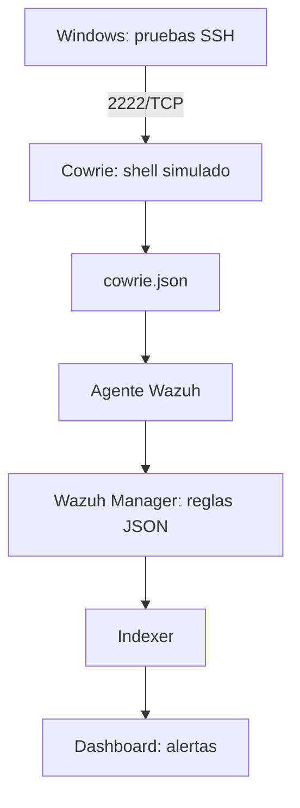

# Laboratorio Cowrie + Wazuh

**Nota de seguridad:** Las IP reales del laboratorio se omitieron por seguridad. Las direcciones `192.0.2.0/24` mostradas son ficticias para documentación; sustitúyelas por las de tu entorno al reproducirlo.

Laboratorio de detección y análisis de interacciones SSH con Cowrie, integrado con Wazuh mediante un agente y reglas personalizadas. Implementado por Alejandro Venegas en Hyper-V para un proyecto técnico de titulación y portafolio.

## Estado comprobado

El 10 de octubre de 2026 se verificó el recorrido completo: Windows → Cowrie → archivo JSON → agente → Wazuh Manager → dashboard. El panel mostró tres alertas de nivel 5, regla 100104, correspondientes a `whoami`, `uname -a` y `exit`.

| Componente | Configuración |
|---|---|
| Host | Windows 11 Pro, 32 GB RAM |
| Wazuh | Ubuntu Server 24.04, Wazuh 4.14.8, 4 vCPU, 8 GB RAM fija, disco 60 GB |
| Cowrie | Ubuntu Server 24.04.5, Cowrie 3.1.1, 2 vCPU, 2 GB RAM fija, disco 25 GB |
| Red | Switch interno Hyper-V Lab-Honeypot, 192.0.2.0/24 |
| Windows | 192.0.2.1 |
| Wazuh | 192.0.2.10 |
| Cowrie | 192.0.2.20; administración SSH 22, honeypot SSH 2222 |

## Arquitectura

## Archivos

- [Implementación](docs/implementacion.md)
- [Validación y resultados](docs/validacion.md)
- [Evaluación experimental](docs/evaluacion.md)
- [Pendientes](docs/pendientes.md)
- `configs/`: ejemplos mínimos, no copias completas de los servidores.
- `rules/cowrie_rules.xml`: reglas personalizadas.
- `examples/`: eventos sintéticos sin contraseñas ni identificadores de sesiones reales.

## Límites actuales

La integración está verificada. El arranque automático de Cowrie y del agente fue verificado tras reiniciar el 10/10/2026. La tarjeta Default Switch de Cowrie fue desconectada y se verificó la recepción de nuevas alertas el 10/10/2026. Cowrie conserva solo la ruta IPv4 del laboratorio; la revisión de rutas IPv6 y reenvío del host queda pendiente. Escuchar solo en la IP del laboratorio no bloquea la salida a Internet. Las configuraciones de este repositorio usan IP ficticias. El switch interno incluye acceso al host Windows; no implica aislamiento total del host. Las pruebas realizadas son controladas y no representan ataques recibidos desde Internet.

## Fuentes

- https://docs.cowrie.org/en/stable/INSTALL.html
- https://documentation.wazuh.com/current/quickstart.html
- https://documentation.wazuh.com/current/user-manual/reference/ossec-conf/localfile.html
- https://documentation.wazuh.com/current/user-manual/ruleset/rules/custom.html
- https://documentation.wazuh.com/current/user-manual/reference/tools/wazuh-logtest.html

Versiones documentadas corresponden al laboratorio; consultar compatibilidad antes de reproducir con versiones nuevas.

## Validación ampliada (11/10/2026)

Las cuatro reglas 100101–100104 se verificaron con alertas reales en el panel. Backend shell y Telnet desactivado fueron comprobados; forwarding SSH se desactivó y Cowrie mantuvo su escucha. No se observó ruta IPv6 por defecto. La política de autenticación de laboratorio acepta únicamente la credencial ficticia definida en configs/userdb.txt.example. Las repeticiones experimentales siguen pendientes.

## Un registro de verificación: 

